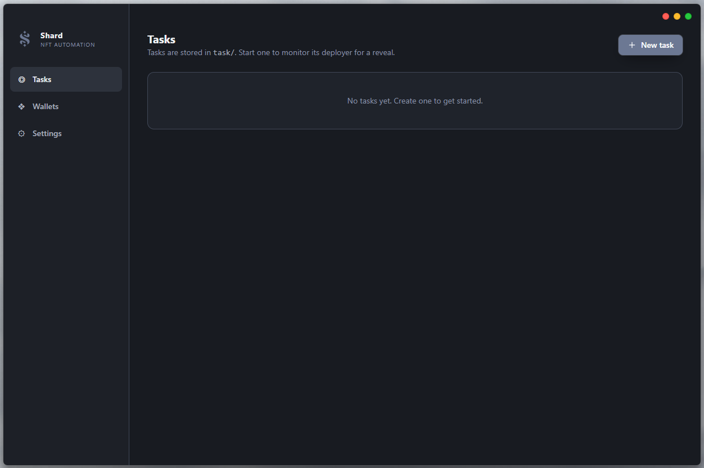
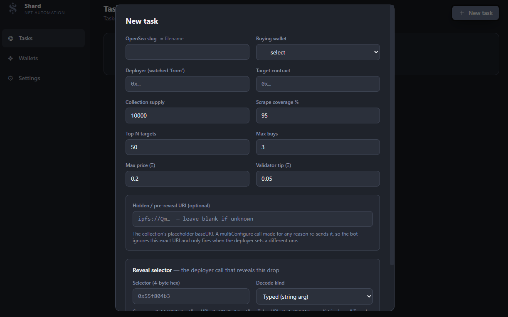
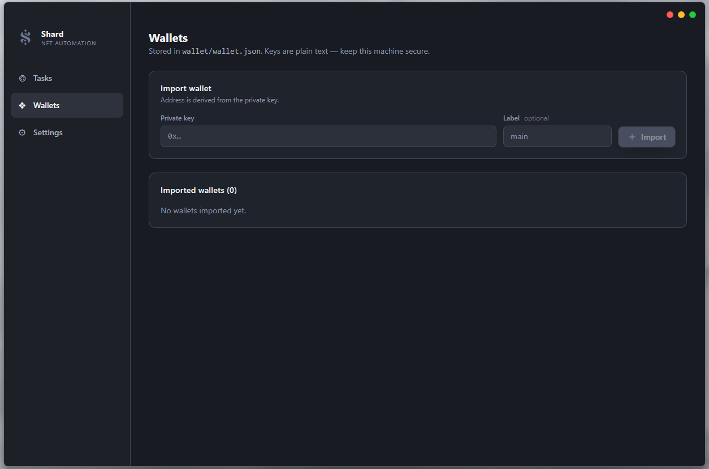
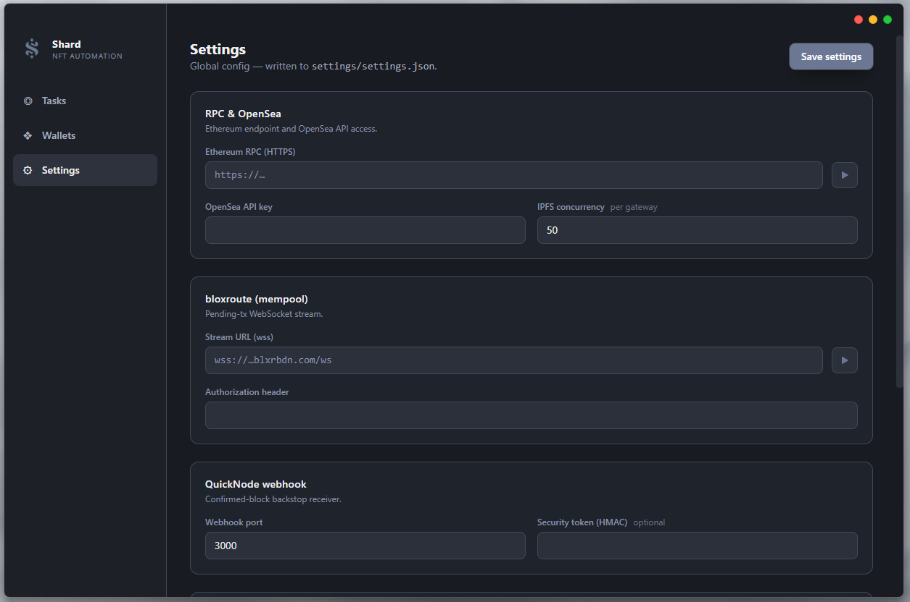

<p align="center">
  
</p>

<h1 align="center">Shard</h1>

<p align="center">
  <b>NFT reveal rarity sniper.</b> Buys the rarest tokens off the floor the moment a collection reveals.<br>
  <sub>Last updated: June 2026 · Status: on hold</sub>
</p>

---

Shard ran live on Ethereum mainnet in June 2026 and landed real snipes. It was then put on hold because NFT market volume dropped too low for the strategy to pay. The code is published as-is for reference and learning.

> [!CAUTION]
> **This software spends real ETH automatically, with no confirmation prompt.** It stores private keys **in plain text**, and its smart contract is **unaudited**. You can lose some or all of the funds you give it. Read [Risks & safety](#risks--safety) first. Nothing here is financial advice.

## Contents

[What it does](#what-it-does) · [The app](#the-app) · [How it works](#how-it-works) · [Design decisions](#design-decisions) · [Setup](#setup) · [Running a task](#running-a-task) · [Running on a VPS](#running-on-a-vps) · [Where everything is stored](#where-everything-is-stored) · [Troubleshooting](#troubleshooting) · [Known limitations](#known-limitations) · [Risks & safety](#risks--safety)

## What it does

Most NFT collections mint "unrevealed": every token shows the same placeholder. Later the team **reveals** the collection with a transaction that points the contract at the real metadata, usually a new IPFS `baseURI`.

Right after the reveal there's a short window. The traits are public, but nobody has ranked them yet. OpenSea hasn't refreshed, rarity sites haven't indexed the collection, and holders who listed near the floor haven't noticed their token is a 1-of-1. **Shard was built to buy those tokens before anyone can see the rarities and delist.** It:

1. Spots the reveal transaction from the collection's deployer.
2. Decodes the new `baseURI` straight from the transaction's calldata.
3. Scrapes the whole collection's metadata from several IPFS gateways at once, while fetching every live OpenSea listing.
4. Ranks every token by rarity (OpenRarity).
5. Buys the rarest listed tokens under your max price **in a single transaction**, sent privately to block builders with a tip.

## The app

A Tauri + React desktop app: set up endpoints once, import a buying wallet, create one **task** per upcoming drop, press start.

| Tasks | New task |
|---|---|
|  |  |
| **Wallets** | **Settings** |
|  |  |

## How it works

```
QuickNode Streams (confirmed blocks) ─┐
bloxroute pendingTxs (mempool, opt.) ─┴─► MonitorHub ─► each task: match deployer → match reveal selector
                                                         → decode baseURI → hidden-URI guard → dedupe
                                                                         │
                              ┌──────────────────────────────────────────┘
                              ▼
         IPFS scrape (N gateways, hedged)  ║  OpenSea listings   (run in parallel)
                              ▼
         OpenRarity scoring → top N ∩ listed ∩ price ≤ max → first max_buys
                              ▼
         OpenSea fulfillment data → ONE RaritySniper.snipe(all orders, tip) → signed offline
                              ▼
         eth_sendBundle → every builder relay × {next block, head+1} → receipt → UI log + Discord
```

A task's stage shows as a badge: `monitoring → scraping → buying → success | failed`, then back to `monitoring`.

## Design decisions

**One rule drives the design: the read path is latency-first, and the send path is correctness-first.** Every millisecond between seeing the reveal and reaching the builders counts. A buy that overpays, or lands NFTs somewhere other than your wallet, is worse than no buy.

**Native Rust core, UI off the hot path.** The pipeline is async Rust (tokio + [alloy](https://github.com/alloy-rs/alloy)). The UI only edits config and displays events: progress is throttled to one update per 100 ms, and Discord notifications are sent after the cycle ends.

### Detecting the reveal

- **QuickNode Streams is the primary source.** It pushes every confirmed block to a local webhook, and the bot checks each block for a transaction from the deployer, so it catches every reveal that lands on-chain.
- **bloxroute is optional.** It sees a reveal in the mempool *before* it's mined, but only if the deployer broadcasts publicly. That head start used to be what won. Now MetaMask sends transactions privately by default (Smart Transactions), and so do private RPCs like Flashbots Protect, so most reveals never reach a mempool feed. **You need one of the two, not both.** If you pick one, pick QuickNode.
- Both feed one shared **MonitorHub**: a single bloxroute connection with one subscription per deployer, shared by every task. A reveal seen by both sources is deduped by its URI.
- **Every task names its reveal selector.** It's the 4-byte selector of the function that sets the real metadata URI, with a decode kind: `Typed` (any single-`string` function) or `MultiConfigure` (an OpenSea Studio tuple, scanned for the URI). There's no built-in guess list, because a guess list fires on the wrong functions or silently misses the right one.

  | Function | Selector | Kind |
  |---|---|---|
  | `setBaseURI(string)` (most common) | `0x55f804b3` | `Typed` |
  | `setBaseTokenURI(string)` | `0x30176e13` | `Typed` |
  | `reveal(string)` | `0x4c261247` | `Typed` |
  | SeaDrop `multiConfigure` (OpenSea Studio) | `0x911f456b` | `MultiConfigure` |
  | `multiConfigure` variant | `0xa64dfa75` | `MultiConfigure` |

  For anything else, use `cast sig "fn(string)"` or the transaction's "Function" field on Etherscan. Never use a placeholder setter like `setNotRevealedURI`.
- **Hidden-URI guard.** Before the reveal, any OpenSea Studio admin call re-sends the placeholder URI. If you set the task's *hidden URI*, those calls are ignored.

### Scraping and ranking

- **Use several IPFS gateways.** Tokens are spread across all of them, each with its own concurrency limit, so throughput grows with every gateway you add. Several Pinata gateways, each with its own token, are recommended.
- **Hedged requests.** If a gateway hasn't answered in 800 ms, the same request goes to the next one, and the first answer wins. Errors fail over immediately.
- **Coverage cutoff.** The scrape stops at `scrape_coverage_pct`% of the supply, because the last few percent are the slow tail.
- **Pre-warmed connections.** Connections are opened when the task starts, so no TLS handshakes are left for reveal time.
- **OpenRarity scoring.** Each trait scores `-log2(frequency)`. A missing trait counts as an explicit "None", and scores are normalized by the collection mean.
- **Listings are fetched during the scrape**, never from a stale cache. The cheapest listing per token wins, and prices are compared in integer wei.

### Buying: one transaction, private bundles

**Your ETH stays in your wallet.** You never fund the contract: each `snipe()` call sends exactly what it needs (listing prices plus tip) and returns anything unspent before the transaction ends.

[`RaritySniper.sol`](snipe-contract/RaritySniper.sol) packs every target into **one transaction** (one nonce, one block) with **keep-winners** semantics. The transaction lands or doesn't as a whole, but each order inside it succeeds or fails on its own:

| Outcome | Cost to you |
|---|---|
| All orders fill | Listing prices + tip + gas |
| Some fill, some fail (e.g. sold a block earlier) | The successful buys **stand**. Failed orders' ETH is **refunded in the same transaction**. You pay the **full tip** plus gas. |
| Nothing fills | The transaction reverts, the builder drops the bundle, and **nothing is charged** |
| Bundle not included | Nothing is charged |

You never pay for an NFT you didn't get. A partial fill still costs the whole tip. The two copies sent to each relay are the *same* signed transaction aimed at two blocks, so only one can land.

- **The tip beats speed.** Builders take the highest-paying bundle. Speed only has to get you to the builders before the block is sealed. After that, the bigger tip wins. This matters even more now that most reveals are seen at block time, when everyone starts racing at once.
- **More builders, more coverage.** A bundle only lands in blocks built by builders you sent it to. The top builders (Titan, Quasar, BuilderNet) build most blocks, but not all, so add more relays. Some validators don't use MEV-Boost at all.
- **Private by design.** The transaction is signed offline and never touches the public mempool, so nobody can copy it, and a losing bid costs nothing.
- **Signed-zone binding.** OpenSea's SignedZone ties each order's signature to the address that fills it. Shard requests fulfillment data with the **contract** as the filler but sets **your wallet** as the recipient, so the order is accepted *and* the NFT lands with you.
- **Gas and nonce.** The nonce and block head are fetched once per reveal, as late as possible. The gas limit is `max(estimate, 80k + 350k × orders) × 1.2`, which is free insurance because you only pay for gas used.

### Config

Settings, wallets, and tasks are small JSON files written atomically. In release builds they live next to the exe, so the whole bot is one portable folder. The deployed contract address is **deliberately hidden from the UI**, so a bad paste can't redirect your buys.

## Setup

**You'll need:** Rust (stable), Node.js 18+, the [Tauri v2 prerequisites](https://v2.tauri.app/start/prerequisites/), and Remix or Foundry to deploy one contract. You also need your own accounts:

| Service | Required? |
|---|---|
| Ethereum mainnet RPC (HTTPS) | **Yes.** Use a fast, paid one |
| [QuickNode Streams](https://www.quicknode.com/streams) | **Recommended.** You need this or bloxroute |
| [bloxroute](https://bloxroute.com) `pendingTxs` WebSocket | Optional |
| IPFS gateways (e.g. [Pinata](https://pinata.cloud) dedicated gateways) | **Yes. Several recommended** |
| [OpenSea API key](https://docs.opensea.io/reference/api-keys) | **Yes** |
| Builder relay URLs (`eth_sendBundle`) | **Yes.** The top builders, plus more for coverage |
| Discord webhook | Optional |
| A **dedicated, funded** buying wallet | **Yes** |

**1. Install and run in dev mode**

```bash
git clone <this-repo-url> rarity-sniper && cd rarity-sniper
npm install                              # Tauri CLI
npm install --prefix ui                  # frontend dependencies
npx tauri icon assets/appicon.png        # generates the (gitignored) app icons
npm run tauri dev
```

**2. Deploy the contract from your buying wallet.** `snipe()` is `onlyOwner`, so the wallet that deploys it must be the wallet that buys. Compile `snipe-contract/RaritySniper.sol` with **solc 0.8.24** in Remix, or with Foundry:

```bash
forge create snipe-contract/RaritySniper.sol:RaritySniper --rpc-url "$ETH_RPC_URL" --private-key "$PRIVATE_KEY" --broadcast
```

Don't send ETH to the contract. `withdraw()` exists only as a safety valve.

**3. Fill in Settings** and use the ▶ test buttons. The fields:
- **RPC, OpenSea key, and IPFS concurrency** (requests in flight *per gateway*, default 50).
- **bloxroute URL and header.** Optional. Leave blank to disable.
- **QuickNode webhook port** (default 3000) and **security token**. Set the token whenever the port is public.
- **Discord webhook.** Optional.
- **IPFS gateways.** A URL like `https://<name>.mypinata.cloud/ipfs/`, plus that gateway's token. Add several.
- **Builder relays.** Add as many as you can.

Settings are read when a task starts, so restart tasks after changing them.

**4. Set the contract address by hand.** Close the app, then set `"sniper_contract": "0x…"` in `settings/settings.json` (under `src-tauri/` in dev mode) and reopen it.

> [!WARNING]
> Nothing guards the zero-address default. **Never start a task until `sniper_contract` is set.**

**5. Import the buying wallet** in the Wallets tab and fund it with enough for `max_buys × max_price + tip + gas`. Keys are stored **unencrypted**, so use a dedicated wallet.

**6. Set up QuickNode Streams.** Create an Ethereum mainnet Stream with full block and transaction payloads, and point it at `http://<your-ip>:3000/webhook`. It must be **`http://`**, not `https://`, because the receiver is plain HTTP. Copy the Stream's `qnsec_…` token into Settings and open port 3000 in your firewall.

## Running a task

Create one task per drop, ideally well before the reveal:

| Field | What to enter |
|---|---|
| OpenSea slug | The collection slug. Also the task's id and filename. |
| Buying wallet | An imported wallet. **It must own the contract.** |
| Deployer | The EOA that will send the reveal (usually the owner). If ownership was transferred, the new owner. Safes and multisigs aren't detected. |
| Reveal selector + kind | **Required.** See the [selector table](#detecting-the-reveal). |
| Hidden URI | Optional. For OpenSea Studio drops, enter the current placeholder URI. |
| Collection supply | IDs `1..=supply` are scraped. |
| Scrape coverage % | 95 to 99 trades a little accuracy for a lot of speed. |
| Top N targets | "How rare is rare enough." 50 to 200 suits a 10k collection. |
| Max buys / Max price (Ξ) | Your real risk limits. Rare tokens are listed *at* the floor because the seller doesn't know yet. |
| Validator tip (Ξ) | **The most important setting.** It's your bid, and the highest bid wins. Size it against what the rarest tokens are worth. |

Press **Start**: the task connects, warms up the gateways, and shows `monitoring`. When the reveal hits you'll see `scraping` (with coverage %), then `buying`, then a line for every target.

## Running on a VPS

**Run Shard on an always-on VPS close to your node.** Most of the time between reveal and bundle is network round trips: to your RPC, the IPFS gateways, OpenSea, and the builder relays. Put the VPS in the same region (ideally the same data center) as your RPC node, and as close as you can to the gateways and builders you use.

**Measure before you commit.** Each ▶ test button in Settings measures that endpoint from the machine running the app: latency and current block for your RPC, and connect time for bloxroute, every IPFS gateway, and every builder relay. Compare VPS locations with it, and drop slow endpoints before a drop.

```bash
npm run tauri build    # → target/release/rarity-sniper-desktop.exe
```

Put the exe in its own folder and **start it by double-clicking it**. That way `settings/`, `wallet/`, `task/`, `logs/`, and `rankings/` all land in that folder, and you can copy the folder between machines. Don't run it from `Program Files` through a Start-menu shortcut: its working directory would be `System32` and writes fail. For QuickNode, open the webhook port in the VPS firewall. It ran in production on a Windows 11 VPS over RDP.

## Where everything is stored

All paths are relative to the exe's folder (`src-tauri/` in dev mode), and all of them are gitignored.

| Path | Contents | Sensitivity |
|---|---|---|
| `wallet/wallet.json` | Imported wallets, **plaintext private keys** | 🔴 Controls your funds |
| `settings/settings.json` | RPC, API keys, gateway tokens, relays, webhook token, Discord URL, contract address | 🔴 Secret |
| `task/<slug>.json` | Per-drop config | 🟡 Reveals strategy |
| `logs/desktop.log.<date>`, `logs/<slug>/<date>[.debug].log`, `logs/monitor/` | App, per-task, and monitor logs (every deployer tx, decoded URI, target, relay result) | 🟡 Addresses, tx hashes |
| `rankings/<slug>.txt` | Top-N token ids from the last reveal | ⚪ |

**Never commit these files, and never screenshot the Wallets tab with a key revealed.** If one leaks, move the funds and rotate the keys. Deleting the file doesn't undo the leak.

## Troubleshooting

| You see | Meaning |
|---|---|
| Stuck on `monitoring`, nothing in the debug log | No transactions from the deployer were seen. Check the deployer (new owner? multisig?) and QuickNode's delivery log. |
| `invalid reveal selector` | The selector is blank or not 4 bytes of hex. |
| `… is not a reveal` | The deployer called a different function. Normal for admin calls. If it *was* the reveal, the selector is wrong. |
| `scrape returned 0 tokens` | The gateways are failing, or the URI shape is unusual. Check `<gateway>/<CID>/1` in a browser. |
| `0 buyable target(s)` | None of the top N were listed under your max price. |
| `0/N relays accepted it` | Check the relay URLs. |
| `accepted … but never included` | Outbid, or the block came from a builder not on your list. Raise the tip or add relays. |
| QuickNode TLS errors / 401 / 200 with no candidates | The destination uses `https://` / the token doesn't match / delivery works, so check the deployer. |

Set `RUST_LOG=debug` for verbose tracing.

## Known limitations

- One reveal function and one buying wallet per task, and each buying wallet needs its own contract deployment.
- Reveals sent from a Safe or multisig aren't detected.
- Only base-URI reveals work. VRF, upgrade, or on-chain-metadata reveals won't trigger.
- Token ids are assumed to be `1..=supply`, so a collection starting at 0 misses token 0.
- OpenSea (Seaport 1.6) on Ethereum mainnet only.
- Rarity isn't value: OpenRarity is statistical, and markets sometimes price "meta" traits differently.
- Third-party APIs change over time. Last verified in **June 2026**.

## Risks & safety

By running this software you accept full responsibility for what it does with your funds.

- **Financial.** It buys automatically with no confirmation, exactly as configured. Rare tokens can still be illiquid, and floors drop. Tips, gas, and API subscriptions cost money win or lose, and in a slow market they can exceed the returns. That's why this project is on hold.
- **Keys.** Private keys sit **unencrypted** in `wallet/wallet.json`, and API keys in `settings.json`. Malware, a synced cloud folder, or a shared machine can drain the wallet. Use a dedicated hot wallet holding only what you need, and sweep profits out regularly.
- **Contract.** `RaritySniper.sol` is **unaudited**. Review it before deploying. It can't receive NFTs, so never change the recipient away from your wallet.
- **Webhook.** An open webhook port **without the HMAC token accepts any POST**. Anyone could forge a "reveal" pointing at metadata they control and steer your buys. Always set the token.
- **Gateway tokens.** If a reveal URI is plain `https://` rather than `ipfs://`, your gateway token is still sent to that host. Use tokens you can rotate.
- **Trust.** Relays, builders, and your RPC see your bundles and could misbehave.
- **Legal and tax.** Check the marketplace and API terms of service and your local tax rules. Shard only buys tokens their owners publicly listed, at the listed price.

**No warranty.** Provided as-is, without warranty of any kind. The authors aren't liable for any loss. **Not financial advice.**

## License

No license: all rights reserved by the author. The Solidity contract carries an `SPDX-License-Identifier: MIT` header.
